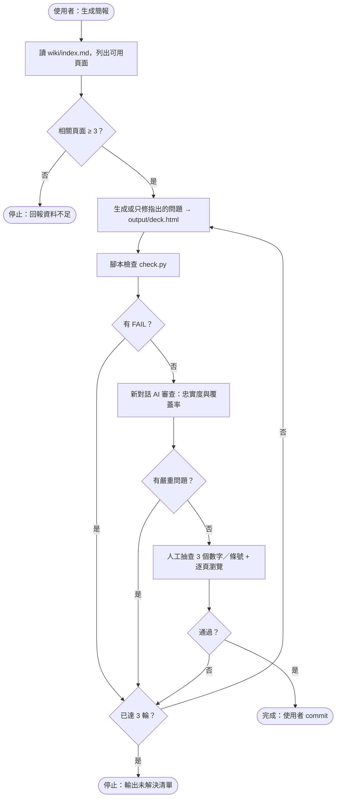

# wiki → 教學簡報 loop

## 1. 目標

只使用 `wiki/` 的內容，產生一份給「沒學過資安的大學生」看的教學簡報，存成 `output/deck.html`（單一自包含 HTML，無外部資源，不用 Marp）。簡報內容必須能對應回 wiki 頁面，wiki 頁面再對應回 raw 來源。

## 2. 限制（違反任一項即視為未完成）

1. 只讀 `wiki/`，**不讀、不引用、不修改 `raw/`**。
2. 不補 wiki 沒有的外部事實；wiki 標【raw 未載，待補來源】的，簡報也要保留該標示或不寫。
3. 每頁（封面與結尾除外，最多豁免 2 頁）必須有出處：`<p class="source">來源：wiki/…/xxx.md</p>`。
4. 保留 wiki 的對象標籤：寫給個人的與寫給企業／服務提供者的內容要在簡報上分清楚。
5. **72 小時**必須寫明出處：是「數發部呼籲」或「GDPR」，**不得寫成個資法規定**（個資法第 12 條第 4 項只授權主管機關訂時限）。
6. **個資法第 27 條**：01 與 03 並列呈現、各自標出處，不裁決、不寫舊條文內容。個資法為「修正版條文（尚未生效）」，不得稱為現行版。
7. 不寫詐騙話術腳本；範例只用虛構資料（王小明、0900-000-000、example.com）。
8. 禁用字眼：脫離歐盟、特種個資、改列第三章之一、移交個資會、不強制定期、安全提問。
9. AI **不執行 git commit**，每輪結束提醒使用者自己 commit。

## 3. 簡報格式約定（check.py 依此檢查）

- 一張投影片 = 一個 `<section class="slide">…</section>`，固定 16:9，內容不得超出版面。
- 出處放在該頁內 `class="source"` 的元素，寫 wiki 相對路徑（例：`wiki/legal/time-limits-comparison.md`）。
- 封面、結尾可在 `<section>` 加 `data-no-source="true"` 豁免出處。
- 頁數 8–15；每頁文字精簡（超過約 400 字會被警告）。
- 全部 CSS、JS 寫在同一個檔案內，圖示用 emoji 或內嵌 SVG，不得引用外部網址。
- 建議大綱：為什麼要在意 → 個資是什麼 → 法律怎麼保護你 → 常見詐騙辨認 → 釣魚與假冒官方 → 帳號與密碼（標明是給業者的規範）→ 外洩後你可以做什麼 → 台灣與歐盟、72 小時對照 → 重點回顧與延伸閱讀。實際以 `wiki/index.md` 列出的頁面為準。

## 4. 完成標準（三關都要過）

| 關卡 | 誰判定 | 通過條件 |
|---|---|---|
| A. 腳本 | `python check.py --round N` | 無 FAIL（WARN 需人工看過） |
| B. AI 審查 | **新對話**的 AI | 忠實度與覆蓋率報告無「嚴重」問題 |
| C. 人工抽查 | 使用者 | 抽 3 個數字或條號回 `raw/` 核對，並開瀏覽器逐頁看 |

「完成」由腳本與使用者決定，AI 不得自行宣告完成。

## 5. 每一輪的步驟

1. 讀 `wiki/index.md`，列出要用到的頁面。**若與簡報主題相關的 wiki 頁面少於 3 頁，停止並回報，不得自行補內容。**
2. 第 1 輪：規劃大綱（頁面 ↔ wiki 頁面對照表）→ 生成 `output/deck.html`。第 2 輪起：**只修上一輪報告列出的問題**，不重寫、不調整沒被點名的頁面。
3. 執行 `python check.py --round N`，產生 `output/check-report-roundN.md`。
4. 有 FAIL → 回到步驟 2（只修 FAIL 與被指出的 WARN）。
5. 腳本通過 → 使用者開**新對話**執行第 7 節的審查 prompt，產生審查報告。
6. 審查有嚴重問題 → 回到步驟 2。
7. 審查通過 → 使用者做人工抽查（關卡 C）。
8. 每輪結束，AI 在 `output/loop-log.md` 追加一筆：輪次、腳本結果、被修的問題、尚未解決的問題，並提醒使用者 commit。

## 6. 停止條件

- **成功**：三關都通過。
- **失敗停止**：連續 3 輪仍有 FAIL 或嚴重問題 → 停止，輸出未解決清單，由使用者決定。
- **資料不足停止**：相關 wiki 頁面少於 3 頁，或某頁需要 wiki 沒有的資訊 → 停止回報，不得編造。

## 7. AI 審查 prompt（必須在新對話，且只提供下列檔案）

提供：`output/deck.html`、簡報引用到的 wiki 頁面、`AGENTS.md`。**不要給 `raw/` 與製作過程的對話。**

```
你是審查者，不是作者。請只根據我提供的 wiki 頁面，審查 deck.html，只出報告、不要修改任何檔案。
1. 忠實度：逐頁列出簡報中 wiki 沒有支持的陳述（含數字、條號、時限、法律效力）。
2. 歸屬：72 小時是否寫明出處為數發部或 GDPR；個資法是否被稱為現行版；第 27 條是否 01、03 並列且未裁決。
3. 對象：個人與企業／服務提供者的內容是否混在一起。
4. 覆蓋率：wiki 的重要內容（個資定義、當事人權利、外洩通知、詐騙辨認、釣魚、密碼、72 小時對照）有哪些簡報沒涵蓋。
5. 教學結構：沒學過資安的大學生是否看得懂，哪幾頁太密或跳太快。
每項標「嚴重／一般／建議」，並指出頁碼。沒有問題的項目寫「未發現」，不要為了湊數編造問題。
```

## 8. Graph（流程圖）



節點錯誤紀錄：本專案實測最容易出錯的節點是「AI 自檢」——lint 報告全 PASS，但腳本抽查發現 source-06 把應排除的原句重現。因此「判定完成」交給腳本與新對話審查，不交給產生內容的 AI。
