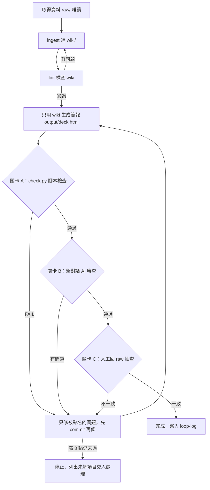

# NCKU E24144189 電機系二年級 江翊誠

## 1. LLM Wiki 主題與簡短介紹

**主題：個人資料保護與資安（給剛接觸資安的大學生）**

這個 wiki 以「個人自保與防詐」為主軸，分兩條線整理：
- 個人自保篇（`wiki/defense/`）：常見五大詐騙手法、個資外洩後的防詐自保四原則、偽冒公務機關郵件的辨識。
- 知法知權篇（`wiki/legal/`）：個資法的個資定義與當事人權利、企業的通知義務、歐盟 GDPR 對照、NIST 密碼指引。

資料來源共 6 份，經 ingest 成 20 頁 wiki（含 index、log、lint 報告）。每頁標示適用對象（個人／企業／服務提供者），並把有爭議的內容（例如個資法修正版尚未生效、第 27 條兩份文獻說法不同、「72 小時」到底是誰規定的）如實並列、不自行裁決。

## 2. LLM Wiki 連結或成果

整個 repo：https://github.com/e24144189-arch/privacy-security-wiki 

## 3. 教學 HTML 簡報連結

https://e24144189-arch.github.io/privacy-security-wiki/output/deck.html

（15 頁，方向鍵換頁）

## 4. loop / graph 流程說明

### 流程

文字版：取得資料 → ingest 進 Wiki → lint → 以 Wiki 為唯一來源生成簡報 → 腳本檢查 → 新對話審查 → 人工抽查 → 完成；任何一關不通過就回到「修正 → 重新生成」。

### 哪些步驟會重複執行？
「生成簡報 → 三道檢查 → 修正」會重複，最多 3 輪。本次實際跑了 3 輪。

### 哪些地方需要檢查或重新生成？
- **關卡 A（`check.py`）**：檢查生成的頁數是否 8–15 頁、每頁有出處、引用的 wiki 頁面存在且不直接引用 raw、禁用字眼、72 小時歸屬、無外部資源、字數、文字不溢出版面。
- **關卡 B（新對話 AI 審查）**：只拿簡報、wiki 與規則，不看製作過程，逐頁對照內容是否有 wiki 沒有的說法，補腳本看不出來的語意問題。
- **關卡 C（人工抽查）**：回 `raw/` 原文，用 `Select-String` 核對最容易錯的內容，紀錄在 `output/spot-check.md`。
- 任一關不通過，就只修被點名的地方，重新生成該部分並再檢查。

### 為什麼這樣設計？
1. **「完成」由腳本與使用者決定，AI 不能自己宣告完成** 實測發現 AI 自我檢查會寫「全部通過」，但實際並沒有。
    AI 的自我限制：簡報內容全部來自 `wiki/` 知識頁面，不補外部事實，所有引號內容逐字照抄 raw 原文。
    原文長什麼樣：「我是○○，我最近換了新電話，以後要用這個號碼來聯繫，記得通訊錄要更新」
    AI實際輸出：句子改變，並未依照規定輸出，如圖1    
2. **作者和審查者分開** 同一個對話容易替自己圓場，新對話沒看過製作過程，才抓得到矛盾。
3. **能用腳本的規則都寫成腳本**（頁數、出處、禁用字眼），把 AI 與人力留給語意判斷。
4. **格式約定放在生成之前**（`SKILL.md`），避免生成完才發現格式不符、腳本無法檢查。
5. **停止條件明確**（成功／3 輪／相關 wiki 頁面不足 3 頁），避免無限修改。

## 5. 一次實際執行的結果與檢查紀錄

以下為本次實際執行（檔案都在專案 `output/`）：

| 輪次 | 做了什麼 | 結果 |
|---|---|---|
| 第 1 輪 | 生成簡報，但沒讀 `SKILL.md`，用自己的標記 | `check.py` 數出 0 頁，格式不符；發現 `check.py` 本身在 0 頁時其他項仍顯示 PASS，修正腳本 |
| 第 2 輪 | 重做，用腳本與逐頁對照 wiki | 修正十幾處 wiki／raw 沒有的說法、混淆處與非逐字引文；密碼頁加中文解釋 |
| 新對話審查 | 另開對話只看簡報、wiki、規則 | 抓到 1 個嚴重矛盾：第 10 頁提示框說「三個來源均提及 72 小時」，同頁表格卻寫個資法沒有；另有禁用詞「改列第三章之一」出現 |
| 第 3 輪 | 修正審查發現的問題 | 8 項檢查無 FAIL；仍有 9 頁字數 WARN（取捨說明見反思） |
| 人工抽查 | 回 raw 核對 4 項（GDPR 72 小時、個資法第 12 條第 4 項、raw/01 無「72」、NIST 節流） | 4 項皆一致 |

完整紀錄：`output/loop-log.md`、`output/check-report-round1~3.md`、`output/review-report-1.md`、`output/spot-check.md`。

## 6. 反思

**哪個節點最常出錯？** 
最常出錯的是「AI 把內容改寫成簡報」以及「AI 檢查自己寫的東西」這兩個節點。
改寫成簡報時，AI 很容易「加料」。第 2 輪拿簡報逐頁對照 wiki，找到幾處 wiki 或 raw 沒有的說法，例如「24 小時免費全年無休」、「詐騙電話可能是偽裝成熟悉號碼」、「未見面絕不先付款」。另外也有搞混的地方：假投資和假交友的出金名目互換、把 2025 年和 2026 年的兩份文件寫成「同日期」。引號裡的字也常常不是原文。
AI 自己檢查自己，會說「通過」。第一次 lint 七項全部 PASS，但我用 `Select-String` 抽查，發現 `source-06` 把應該排除的那句疑似錯誤的原文整句放進頁面。第 1 輪簡報的日誌也寫「品質自查全部通過」，包括「字體不小於 24px」，實際內文只有 14px。

**把檢查前移到哪？**
1. 把「完成」的判定從 AI 移到腳本和新對話，利用 `check.py` 自動檢查裡面的一些禁止事項，AI 沒辦法自己宣告完成。
2. 第 1 輪簡報的格式不符，是因為 AI 沒讀到 `SKILL.md`，用了自己的標記，`check.py` 因此輸出 0 頁。後來把 `<section class="slide">`、`class="source"` 的約定寫進 `SKILL.md`，生成前就要讀。
3. 新對話只拿簡報、wiki 和規則，不看製作過程。它抓到一個 `check.py` 抓不到的嚴重錯誤：簡報第 10 頁提示框寫「三個來源均提及 72 小時」，但同頁表格寫個資法母法沒有 72 小時，這種語意矛盾腳本看不出來
4. 人工抽查放在最後一關

**有沒有修改 workflow？為什麼？**
有。
1. 先確認工具真的能跑再交給 loop——我的電腦只有 Windows Store 的 Python 捷徑，`python check.py` 沒有輸出也沒有報錯，差點誤認為通過
2. 每輪先 commit 再修，這樣修正前後都有紀錄可以對照。
3. 只修被點名的問題，不整份重寫
4. 規則放在檔案而不是對話記憶，所以 Antigravity 額度用完後能換工具(和claude)接續將內容完成
5. 增加「新對話審查」與「人工抽查」兩道關卡。

**還沒解決的限制：** 
1. `check.py` 看不出語意
2. 人工抽查只做 4 項
3. 部分頁面字數偏多
4. 個資法修正版「現行實務採用哪版」仍待使用者確認
若重做，我會寫「引號內文字自動到 raw 搜尋」的腳本，把非逐字引用的問題在第 1 輪就抓出來。

## 7. AI 使用說明

**使用的 AI 工具**
- Antigravity（AI 編程代理）：【請確認】把 `raw/` 的 6 份資料 ingest 成 wiki 頁面、lint，並產生第 1 輪簡報。
- Claude：協助設計 `AGENTS.md` 之外的 loop 規則（`SKILL.md`）、撰寫檢查腳本 `check.py`、第 2–3 輪簡報修正、加入換頁動態效果，並草擬 `loop-log.md`、`spot-check.md` 與反思初稿。Antigravity 額度用完後，由 Claude 接手後續輪次。
- 另一個新開啟的 AI 對話：【請確認是哪個工具】只拿簡報、wiki 與規則做獨立審查，產出 `review-report-1.md`。

**AI 做了什麼、我做了什麼**

| 工作 | AI | 我 |
|---|---|---|
| 選主題、決定受眾與簡報風格 | 提供選項 | 決定（大學生、親切插畫感） |
| 蒐集 `raw/` 資料 | — | 選定 6 份來源並放入 raw/ |
| ingest 成 wiki、lint | 撰寫與初檢 | 用 `Select-String` 抽查、要求修正、逐次 commit |
| 生成簡報、修正 | 撰寫與修改 | 提出修改要求（中文解釋、動態效果）、驗收 |
| 檢查腳本與 loop 規則 | 撰寫 | 實際執行、回報輸出、發現工具問題（Python 未安裝） |
| 人工抽查（關卡 C） | 協助設計抽查項目 | 親自執行指令並對照 raw 原文 |
| 反思 | 提供初稿 | 以自己的話改寫【請確認已完成】 |

**如何降低 AI 出錯的風險**
- `raw/` 設為唯讀，簡報只能引用 `wiki/`，每頁標明 wiki 出處。
- AI 不能自行宣告完成，由 `check.py`、新對話審查與我的人工抽查決定。
- 實際發現 AI 會加料、引文不逐字、自我檢查誤報通過，這些錯誤與修正都留在 `output/loop-log.md` 與 git 歷史中。

**誠實聲明：** 
簡報與 wiki 的文字大部分由 AI 生成，我負責選資料、設定規則、執行檢查、抽查與驗收；人工只核對了 4 項，並非每一句都親自比對 raw。個資法修正版是否現行，我沒有自行下結論，簡報中已標【待使用者確認】。

## 參考資料來源

本專案 wiki 的 6 份原始資料
1. 臺灣個人資料保護法（114 年修正版，尚未生效）：https://law.moj.gov.tw/LawClass/LawAll.aspx?PCode=I0050021
2. 165 全民防騙網：常見詐騙手法：https://165.npa.gov.tw/#/articles/6
3. 數位發展部資通安全署：AI 網攻與個資外洩新聞稿：https://moda.gov.tw/ACS/press/news/press/21422
4. TWCERT/CC：社交工程與網站假冒防範：https://www.twcert.org.tw/tw/cp-104-10015-84f6f-1.html
5. NIST SP 800-63B：數位身分指引（驗證方密碼要求）：https://pages.nist.gov/800-63-4/sp800-63b.html#appA
6. 維基百科：一般資料保護規則（GDPR）：https://zh.wikipedia.org/zh-tw/一般資料保護規則
